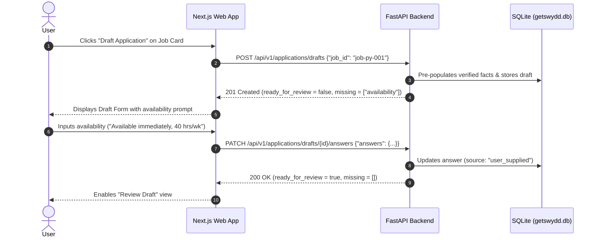

# GetSwydd API Contract

This document specifies the REST API contract implemented in the FastAPI backend (`api/`) for GetSwydd, including job discovery and the application drafting flow.

## Base URL & Configuration
- **Local Development:** `http://127.0.0.1:8000`
- **Allowed Frontend Origins:** `http://localhost:3000`, `http://127.0.0.1:3000`
- **Persistence:** SQLite (`getswydd.db`), surviving server restarts.

---

## 1. System & Jobs Endpoints

### 1.1 Health Check
Checks service availability.

- **Route:** `GET /health`
- **Method:** `GET`
- **Status Code:** `200 OK`

#### Response:
```json
{
  "status": "healthy",
  "service": "getswydd-api",
  "version": "0.1.0"
}
```

---

### 1.2 Job Catalog
Retrieves open job opportunities.

- **Route:** `GET /api/v1/jobs`
- **Method:** `GET`
- **Status Code:** `200 OK`

#### Response:
```json
{
  "total": 2,
  "jobs": [
    {
      "id": "job-py-001",
      "title": "Python Developer Internship",
      "company": "Aether Labs",
      "location": "Cardiff, UK (Hybrid)",
      "eligibility": "Students or recent grads proficient in Python 3, FastAPI or Flask, and basic Git workflow",
      "recommended_resume": "Backend_Python_Intern_Resume.pdf",
      "description": "Build scalable API microservices and automated job ingestion pipelines with Python and FastAPI.",
      "posted_date": "2026-11-20"
    },
    {
      "id": "job-da-002",
      "title": "Data Analyst Internship",
      "company": "Cymru Insights",
      "location": "Remote",
      "eligibility": "Proficiency in SQL, Python (pandas), and data visualization with strong communication skills",
      "recommended_resume": "Data_Analytics_Resume.pdf",
      "description": "Analyze labor market trends, extract job market insights, and assist in matching algorithms.",
      "posted_date": "2026-11-21"
    }
  ]
}
```

---

## 2. Application Draft Endpoints

The drafting flow adheres to **Rule 1 (Verified Facts Only)**: questions with verified profile facts are pre-populated; questions without verified facts (such as availability) are never guessed or hallucinated.

### 2.1 Create Application Draft
Initiates a draft for a target job. Pre-populates screening answers from verified candidate facts and selects the job's recommended resume.

- **Route:** `POST /api/v1/applications/drafts`
- **Method:** `POST`
- **Status Codes:**
  - `201 Created`: Draft created and stored in SQLite.
  - `404 Not Found`: Given `job_id` does not exist.

#### Request Body:
```json
{
  "job_id": "job-py-001"
}
```

#### Response (201 Created):
```json
{
  "id": "draft-a1b2c3d4e5",
  "job_id": "job-py-001",
  "job_title": "Python Developer Internship",
  "company": "Aether Labs",
  "candidate_name": "Alex Morgan",
  "selected_resume": "Backend_Python_Intern_Resume.pdf",
  "screening_questions": [
    {
      "id": "python_experience",
      "question": "What experience do you have with Python, FastAPI, and backend development?",
      "required": true,
      "answer": "Proficient in Python 3, FastAPI, and Flask with 2 years of project and coursework experience.",
      "source": "verified_profile"
    },
    {
      "id": "work_authorization",
      "question": "Are you legally authorized to work in the UK for this role?",
      "required": true,
      "answer": "Authorized to work in the UK without visa sponsorship required.",
      "source": "verified_profile"
    },
    {
      "id": "availability",
      "question": "What is your earliest start date and weekly availability (e.g. 40 hours/week)?",
      "required": true,
      "answer": null,
      "source": null
    }
  ],
  "missing_required_questions": [
    "availability"
  ],
  "ready_for_review": false,
  "created_at": "2026-11-22T10:15:00.000000+00:00",
  "updated_at": "2026-11-22T10:15:00.000000+00:00"
}
```

#### Error Response (404 Not Found):
```json
{
  "detail": "Job not found with ID 'job-unknown-999'"
}
```

---

### 2.2 Retrieve Application Draft
Retrieves an existing draft by ID from SQLite storage.

- **Route:** `GET /api/v1/applications/drafts/{draft_id}`
- **Method:** `GET`
- **Status Codes:**
  - `200 OK`: Draft found.
  - `404 Not Found`: Draft ID does not exist.

#### Example Request:
`GET /api/v1/applications/drafts/draft-a1b2c3d4e5`

#### Response (200 OK):
Returns the complete `ApplicationDraft` object as detailed above.

#### Error Response (404 Not Found):
```json
{
  "detail": "Application draft not found with ID 'draft-nonexistent'"
}
```

---

### 2.3 Update Screening Answers
Supplies user answers for missing screening questions (or updates existing answers). Recomputes `missing_required_questions` and transitions `ready_for_review` to `true` when all required questions are answered.

- **Route:** `PATCH /api/v1/applications/drafts/{draft_id}/answers` (or `PUT`)
- **Method:** `PATCH` / `PUT`
- **Status Codes:**
  - `200 OK`: Answers updated successfully.
  - `400 Bad Request`: Payload contains an invalid question ID.
  - `404 Not Found`: Draft ID does not exist.

#### Request Body:
```json
{
  "answers": {
    "availability": "Available immediately from June 1st, 40 hours per week."
  }
}
```

#### Response (200 OK):
```json
{
  "id": "draft-a1b2c3d4e5",
  "job_id": "job-py-001",
  "job_title": "Python Developer Internship",
  "company": "Aether Labs",
  "candidate_name": "Alex Morgan",
  "selected_resume": "Backend_Python_Intern_Resume.pdf",
  "screening_questions": [
    {
      "id": "python_experience",
      "question": "What experience do you have with Python, FastAPI, and backend development?",
      "required": true,
      "answer": "Proficient in Python 3, FastAPI, and Flask with 2 years of project and coursework experience.",
      "source": "verified_profile"
    },
    {
      "id": "work_authorization",
      "question": "Are you legally authorized to work in the UK for this role?",
      "required": true,
      "answer": "Authorized to work in the UK without visa sponsorship required.",
      "source": "verified_profile"
    },
    {
      "id": "availability",
      "question": "What is your earliest start date and weekly availability (e.g. 40 hours/week)?",
      "required": true,
      "answer": "Available immediately from June 1st, 40 hours per week.",
      "source": "user_supplied"
    }
  ],
  "missing_required_questions": [],
  "ready_for_review": true,
  "created_at": "2026-11-22T10:15:00.000000+00:00",
  "updated_at": "2026-11-22T10:18:30.000000+00:00"
}
```

#### Error Response (400 Bad Request):
```json
{
  "detail": "Question 'invalid_field_id' is not a valid screening question for this draft."
}
```

---

## 3. Frontend Integration Flow



---

## 4. Approved Test Submission
Send `POST /api/v1/applications/drafts/{draft_id}/submit` after the candidate has reviewed the saved answers and selected resume name and explicitly approved that draft version.

```json
{
  "approved": true,
  "draft_updated_at": "2026-11-22T10:18:30.000000+00:00"
}
```

Use the draft's exact `updated_at` value. The server stores the approved payload in the local test employer's SQLite inbox and returns `200 OK` with a receipt. The receipt contains `id`, `draft_id`, `job_title`, `company`, `selected_resume`, `approved_updated_at`, `submitted_at`, `destination` (`local_test_employer`), and `status` (`submitted`). This sends sample data only to the local test inbox.

Repeated requests for the same draft version return the original receipt. The endpoint returns `404` for an unknown draft, `409` for a stale version or incomplete draft, and `422` without explicit approval. Draft responses include `submission`, which is null until the receipt exists. Updates to submitted drafts return `409`.

`GET /api/v1/applications` returns the confirmed test receipts in newest-first order for the application tracker.
