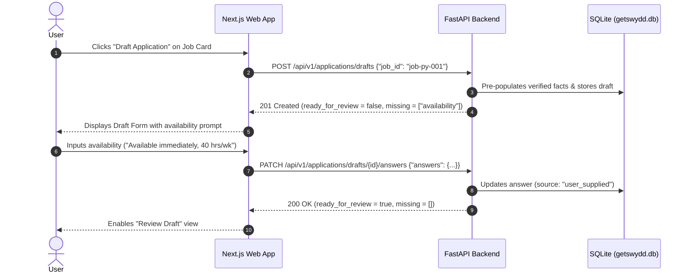

# GetSwydd API Contract

This document specifies the REST API contract implemented in the FastAPI backend (`api/`) for GetSwydd, including job discovery and the application drafting flow.

## Base URL & Configuration

- The local API runs at `http://127.0.0.1:8000`. Start it with `--env-file .env` from `api/` as shown in the [README](../README.md#backend).
- The API allows local frontend requests from `http://localhost:3000` and `http://127.0.0.1:3000`.
- SQLite persists the catalog, profile, and drafts across restarts. The default database filename is `getswydd.db`.

---

## 1. System & Jobs Endpoints

### 1.1 Health Check
Checks service availability.

- **Route:** `GET /health`
- **Method:** `GET`
- **Status Code:** `200 OK`

#### Response:
```json
{
  "status": "healthy",
  "service": "getswydd-api",
  "version": "0.1.0"
}
```

---

### 1.2 Job Catalog
Lists demo roles by default. Use `source=live` for configured public employer feeds or `source=all` to include both. See [live discovery](#11-unified-job-discovery-and-analysis) for refreshing the catalog.

- **Route:** `GET /api/v1/jobs`
- **Method:** `GET`
- **Status Code:** `200 OK`

#### Demo response excerpt
```json
{
  "total": 2,
  "jobs": [
    {
      "id": "job-py-001",
      "title": "Python Developer Internship",
      "company": "Aether Labs",
      "location": "Bengaluru, India (Hybrid)",
      "eligibility": "Students or recent grads proficient in Python 3, FastAPI or Flask, and basic Git workflow",
      "recommended_resume": "Backend_Python_Intern_Resume.pdf",
      "description": "Build scalable API microservices and automated job ingestion pipelines with Python and FastAPI.",
      "posted_date": "2026-11-20"
    },
    {
      "id": "job-da-002",
      "title": "Data Analyst Internship",
      "company": "Cymru Insights",
      "location": "Remote",
      "eligibility": "Proficiency in SQL, Python (pandas), and data visualization with strong communication skills",
      "recommended_resume": "Data_Analytics_Resume.pdf",
      "description": "Analyze labor market trends, extract job market insights, and assist in matching algorithms.",
      "posted_date": "2026-11-21"
    }
  ]
}
```

---

## 2. Application Draft Endpoints

The drafting flow adheres to **Rule 1 (Verified Facts Only)**: questions with verified profile facts are pre-populated; questions without verified facts (such as availability) are never guessed or hallucinated.

### 2.1 Create Application Draft
Initiates a draft for a target job. Pre-populates screening answers from verified candidate facts and selects the job's recommended resume.

- **Route:** `POST /api/v1/applications/drafts`
- **Method:** `POST`
- **Status Codes:**
  - `201 Created`: Draft created and stored in SQLite.
  - `404 Not Found`: Given `job_id` does not exist.

#### Request Body:
```json
{
  "job_id": "job-py-001"
}
```

#### Response (201 Created):
```json
{
  "id": "draft-a1b2c3d4e5",
  "job_id": "job-py-001",
  "job_title": "Python Developer Internship",
  "company": "Aether Labs",
  "candidate_name": "Alex Morgan",
  "selected_resume": "Backend_Python_Intern_Resume.pdf",
  "screening_questions": [
    {
      "id": "python_experience",
      "question": "What experience do you have with Python, FastAPI, and backend development?",
      "required": true,
      "answer": "Proficient in Python 3, FastAPI, and Flask with 2 years of project and coursework experience.",
      "source": "verified_profile"
    },
    {
      "id": "work_authorization",
      "question": "Are you legally authorized to work in the UK for this role?",
      "required": true,
      "answer": "Authorized to work in the UK without visa sponsorship required.",
      "source": "verified_profile"
    },
    {
      "id": "availability",
      "question": "What is your earliest start date and weekly availability (e.g. 40 hours/week)?",
      "required": true,
      "answer": null,
      "source": null
    }
  ],
  "missing_required_questions": [
    "availability"
  ],
  "ready_for_review": false,
  "created_at": "2026-11-22T10:15:00.000000+00:00",
  "updated_at": "2026-11-22T10:15:00.000000+00:00"
}
```

#### Error Response (404 Not Found):
```json
{
  "detail": "Job not found with ID 'job-unknown-999'"
}
```

---

### 2.2 Retrieve Application Draft
Retrieves an existing draft by ID from SQLite storage.

- **Route:** `GET /api/v1/applications/drafts/{draft_id}`
- **Method:** `GET`
- **Status Codes:**
  - `200 OK`: Draft found.
  - `404 Not Found`: Draft ID does not exist.

#### Example Request:
`GET /api/v1/applications/drafts/draft-a1b2c3d4e5`

#### Response (200 OK):
Returns the complete `ApplicationDraft` object as detailed above.

#### Error Response (404 Not Found):
```json
{
  "detail": "Application draft not found with ID 'draft-nonexistent'"
}
```

---

### 2.3 Update Screening Answers
Supplies user answers for missing screening questions (or updates existing answers). Recomputes `missing_required_questions` and transitions `ready_for_review` to `true` when all required questions are answered.

- **Route:** `PATCH /api/v1/applications/drafts/{draft_id}/answers` (or `PUT`)
- **Method:** `PATCH` / `PUT`
- **Status Codes:**
  - `200 OK`: Answers updated successfully.
  - `400 Bad Request`: Payload contains an invalid question ID.
  - `404 Not Found`: Draft ID does not exist.

#### Request Body:
```json
{
  "answers": {
    "availability": "Available immediately from June 1st, 40 hours per week."
  }
}
```

#### Response (200 OK):
```json
{
  "id": "draft-a1b2c3d4e5",
  "job_id": "job-py-001",
  "job_title": "Python Developer Internship",
  "company": "Aether Labs",
  "candidate_name": "Alex Morgan",
  "selected_resume": "Backend_Python_Intern_Resume.pdf",
  "screening_questions": [
    {
      "id": "python_experience",
      "question": "What experience do you have with Python, FastAPI, and backend development?",
      "required": true,
      "answer": "Proficient in Python 3, FastAPI, and Flask with 2 years of project and coursework experience.",
      "source": "verified_profile"
    },
    {
      "id": "work_authorization",
      "question": "Are you legally authorized to work in the UK for this role?",
      "required": true,
      "answer": "Authorized to work in the UK without visa sponsorship required.",
      "source": "verified_profile"
    },
    {
      "id": "availability",
      "question": "What is your earliest start date and weekly availability (e.g. 40 hours/week)?",
      "required": true,
      "answer": "Available immediately from June 1st, 40 hours per week.",
      "source": "user_supplied"
    }
  ],
  "missing_required_questions": [],
  "ready_for_review": true,
  "created_at": "2026-11-22T10:15:00.000000+00:00",
  "updated_at": "2026-11-22T10:18:30.000000+00:00"
}
```

#### Error Response (400 Bad Request):
```json
{
  "detail": "Question 'invalid_field_id' is not a valid screening question for this draft."
}
```

---

## 3. Frontend Integration Flow



---

## 4. Approved Test Submission
Send `POST /api/v1/applications/drafts/{draft_id}/submit` after the candidate has reviewed the saved answers and selected resume name and explicitly approved that draft version.

```json
{
  "approved": true,
  "draft_updated_at": "2026-11-22T10:18:30.000000+00:00"
}
```

Use the draft's exact `updated_at` value. The server stores the approved payload in the local test employer's SQLite inbox and returns `200 OK` with a receipt. The receipt contains `id`, `draft_id`, `job_title`, `company`, `selected_resume`, `approved_updated_at`, `submitted_at`, `destination` (`local_test_employer`), and `status` (`submitted`). This sends sample data only to the local test inbox.

Repeated requests for the same draft version return the original receipt. The endpoint returns `404` for an unknown draft, `409` for a stale version or incomplete draft, and `422` without explicit approval. Draft responses include `submission`, which is null until the receipt exists. Updates to submitted drafts return `409`.

`GET /api/v1/applications` returns the confirmed test receipts in newest-first order for the application tracker.

## 5. Resumes and Confirmed Profile

| Endpoint | Request and response |
|---|---|
| `POST /api/v1/resumes` | Upload a multipart `file` field with a PDF or DOCX up to 5 MB. Returns the resume detail with `201`. Unsupported formats return `415`, oversize files return `413`, and unreadable files return `422`. |
| `GET /api/v1/resumes` | Lists uploaded resumes with their IDs, filenames, upload timestamps, and review status. |
| `GET /api/v1/resumes/{id}` | Returns a resume's extracted text, suggested facts, confirmed facts (initially `null`), and review revision. |
| `DELETE /api/v1/resumes/{id}` | Removes the upload and its contribution to matching. Returns `204`, including on retries after removal. |
| `PUT /api/v1/resumes/{id}/review` | Takes the current `revision`, the complete reviewed `facts` object, and optional `contact`. Returns the updated resume detail. Returns `409` if the revision is stale. |
| `GET /api/v1/profile` | Returns `facts`, an array of merged profile facts with `category`, `value`, and `sources`. Each source includes its resume ID and filename. |

The review payload uses five groups of strings. Omit a group or send an empty array to confirm zero facts for that group.

```json
{
  "revision": 0,
  "facts": {
    "skills": ["Python", "SQL"],
    "education": ["B.Tech Computer Science"],
    "experience": [],
    "projects": ["Built a job tracker"],
    "certifications": []
  }
}
```

Suggestions come from text under common resume section headings. Reviewers can correct or remove any suggestion before confirming it. The profile merges equal facts within each category without regard to case or repeated spaces and retains every confirmed source. Files and profile data are stored locally in SQLite. The sample application workflow continues to use its synthetic candidate.

Resume detail also returns `suggested_contact` and `confirmed_contact` for email, phone, LinkedIn, and GitHub. Suggestions use visible contact text and supported PDF or DOCX hyperlink targets. An existing upload is reprocessed when reopened. Previously confirmed facts remain available for review alongside the new suggestions. Sending `contact` confirms the supplied fields for that resume. Send null values inside the object to clear fields or omit the object to preserve previously confirmed contact details.

New drafts copy confirmed contact details from the selected resume and prefill supported contact questions when a text field is available. The assisted application packet offers those details for copying into the official form. Existing drafts retain their snapshots after the original upload is removed. A fact confirmed on another resume stays in the profile.

## 6. Explainable Job Matching

`GET /api/v1/jobs` includes a `match` object for each sample role. It contains:

- `has_confirmed_profile`, `matched_skills`, and `total_skills`. The counts cover skill groups only. For an alternative such as FastAPI or Flask, either skill supports the group once.
- `requirements`, with a label, status, and confirmed evidence and resume sources. Status is `evidence_found`, `no_confirmed_evidence`, or `needs_confirmation`. Student or recent-graduate status and work authorization need confirmation and do not enter the counts.
- `recommended_resume`, with the uploaded resume ID, filename, and the skill requirements that document supports. The reviewed resume with the most covered groups wins. Ties use filename and then ID. An empty match yields `null`.

Rules use explicit skill names and aliases from confirmed profile facts, with case and whitespace normalized. The sample catalog order and top-level `recommended_resume` field are preserved. That top-level field supplies the synthetic test draft's filename. Personal resume recommendations are in `match.recommended_resume`.

## 7. Personalized Application Drafts

Use `GET /api/v1/profile/application-details` to load the candidate's saved application details. Use `PATCH` on the same path to update the general profile fields shown in the app. A name is required to start a personalized draft. Availability is optional. Omit a field to preserve it or send `null` to clear it.

```json
{
  "candidate_name": "Casey Doe",
  "availability": "June, 20 hours per week"
}
```

The profile page leaves work authorization to the employer's application questions. Legacy clients can still replace application details with `PUT`, which accepts `uk_work_authorization` as `authorized`, `not_authorized`, or `null`. Legacy answers only apply to explicit UK requirements.

To start a personalized draft, send the selected upload's ID in the existing create request:

```json
{
  "job_id": "job-py-001",
  "resume_id": "resume-<id from GET /api/v1/resumes>"
}
```

The API returns `201` with the existing draft fields plus:

- `mode: "personalized"` and `resume_id` identifying the chosen upload. `candidate_name` and `selected_resume` contain the name and filename shown to the candidate.
- Each `screening_questions` item includes an `evidence` array. Resume-based entries have `value` and `resume: { "resume_id": "...", "filename": "..." }`. Confirmed profile entries have `value` and `profile_field` (`availability` or `uk_work_authorization`). Unanswered questions return `answer: null` and an empty `evidence` array.
- `missing_required_questions` and `ready_for_review` remain the controls for the review screen. A user edit has `source: "user_supplied"` and clears the corresponding prefill evidence.

Example response excerpt when the user still needs to answer the work authorization question:

```json
{
  "mode": "personalized",
  "resume_id": "resume-example",
  "candidate_name": "Casey Doe",
  "selected_resume": "Backend.pdf",
  "screening_questions": [
    {
      "id": "work_authorization",
      "question": "Are you legally authorized to work in India for this role?",
      "required": true,
      "answer": null,
      "source": null,
      "evidence": []
    }
  ],
  "missing_required_questions": ["work_authorization"],
  "ready_for_review": false
}
```

An unknown resume returns `404`. An unreviewed resume or a missing candidate name returns `409` with a `detail` message. Drafts retain their original profile snapshot after later edits to the profile or resume review. Sending only `job_id` creates a `demo` draft eligible for the test inbox. Personalized drafts are saved for review, and their submission endpoint returns `409`.

## 8. Greenhouse Job Discovery

In the PowerShell terminal that runs FastAPI, set `GETSWYDD_GREENHOUSE_BOARDS` to a JSON object mapping up to five approved public board tokens to their employer display names. Use the board token from the Greenhouse link on the employer's own careers page.

```powershell
$env:GETSWYDD_GREENHOUSE_BOARDS = '{"board-token":"Employer Name"}'
```

Start or restart FastAPI from that terminal. To sync a board and read the imported jobs:

```powershell
Invoke-RestMethod -Method Post "http://127.0.0.1:8000/api/v1/jobs/greenhouse/refresh"
Invoke-RestMethod "http://127.0.0.1:8000/api/v1/jobs?source=greenhouse"
```

- **Refresh** returns one record per configured board with `board`, `status`, and `count`. Status is `refreshed`, `cached` (the last success was less than five minutes ago), or `failed` (the last successful snapshot is kept). A successful refresh replaces the board snapshot, including removing jobs the feed no longer lists. With zero configured boards, refresh returns `[]`.
- **List** accepts `source=demo` (the default), `source=greenhouse`, or `source=all`. It reads the local snapshot. Each Greenhouse job has `source: "greenhouse"`, `application_mode: "assisted"`, an HTTPS `apply_url` from the provider, a plain-text description, and `source_fetched_at`. The provider's update timestamp is `source_updated_at`. For imported jobs, `posted_date`, `eligibility`, and the top-level demo resume may be null.
- **Matching** compares recognized skill mentions in the description against confirmed profile facts. `match.scope` is `description_mentions`. Display those as skill mentions, since employer requirements and eligibility still need review. When none of the supported skills appear, `match` is null. For boards whose descriptions exceed the response limit, the importer uses the provider's shorter feed, which contains links but may omit descriptions and matches.
- **Apply** shows a link to `apply_url` for `application_mode: "assisted"`. To prepare a draft first, follow section 9. The user completes the application on the employer's page.

An invalid board configuration returns `503` on Greenhouse-specific queries. Greenhouse receives public listing and form reads. Candidate details and resumes stay local.

## 9. Assisted Applications for Live Jobs

Send the imported job ID and a reviewed resume ID to `POST /api/v1/applications/drafts`:

```json
{
  "job_id": "greenhouse:example:123",
  "resume_id": "resume-example"
}
```

On `201`, the existing draft response includes `mode: "assisted"`, the selected resume, confirmed name, and `apply_url`. Show **Open employer application** using the returned URL. A missing reviewed resume or confirmed candidate name returns `409`. A job outside the configured, cached listings returns `404`. If Greenhouse confirms the posting closed, creation returns `409` and asks for a job refresh.

Greenhouse drafts can include imported questions. Lever and Ashby drafts return `form_status: "unavailable"` and direct the candidate to the employer's form.

| Field | Frontend behavior |
|---|---|
| `form_status: "loaded"` | Show the imported custom text and single-select questions below the profile information. |
| `form_status: "partial"` | Show the questions that could be imported and tell the user to complete the other fields on the employer's page. |
| `form_status: "unavailable"` | Show the employer link and selected resume so the user can continue. The draft has no imported questions. |
| `screening_questions[].choices` | Use a text input if empty, otherwise offer the listed values. Save by sending the selected label as the answer string. |
| `ready_for_review` | Reports completion of the local screening questions. The employer's form may ask for additional information. |

Use the existing answer update route to save changes. Prefill requires a direct match to a supported confirmed profile field. Other responses remain blank until the user fills them in. In the assisted flow, complete uploads, consent, and demographic fields on the employer's page.

Use `GET /api/v1/applications/assisted` to list the real drafts in the tracker. After the user says they finished on the employer's site, send `PUT /api/v1/applications/drafts/{id}/reported-submission` with `{"submitted":true}`. The response combines the tracker status and job details:

```json
{
  "draft_id": "draft-example",
  "job_id": "greenhouse:example:123",
  "job_title": "Backend Internship",
  "company": "Example Employer",
  "selected_resume": "Backend.pdf",
  "apply_url": "https://job-boards.greenhouse.io/example/jobs/123",
  "status": "submitted",
  "status_source": "user_reported",
  "reported_submitted_at": "2026-11-22T12:00:00Z",
  "updated_at": "2026-11-22T12:00:00Z"
}
```

Before reporting, entries have `status: "draft"`, `status_source: "getswydd"`, and a null submission time. Repeating a report returns the same timestamp, and reported drafts become read-only. The original test inbox endpoint accepts demo drafts.

### 9.1 Employer-authorized Greenhouse submission

Both AI Search and the job catalog open the same application draft. On the local GetSwydd API, set `GETSWYDD_GREENHOUSE_SUBMISSION_KEYS` to a JSON map of opted-in board tokens to employer-issued Job Board API keys. The board must also be present in `GETSWYDD_GREENHOUSE_BOARDS`. Keep the keys in the API's environment and bind this single-user API to loopback. See the [Greenhouse Job Board API](https://docs.greenhouse.io/job-board#submit-an-application).

Create a fresh draft after enabling the board. Supported forms have `greenhouse_form_hash` set and show the contact fields alongside the screening questions. Review those answers and the selected PDF or DOCX. Forms with unsupported required fields, location, or compliance questions use the employer form.

After explicit approval, send `POST /api/v1/applications/drafts/{id}/employer-submission` with `{"approved":true,"draft_updated_at":"<reviewed version>"}`. The API rechecks the employer form and the draft version, validates required fields, and attaches the original reviewed resume.

| Result | Behavior |
|---|---|
| `employer_submission_status: "submitted"` | Greenhouse accepted the request. The tracker displays an employer-confirmed application. |
| `employer_submission_status: "sending"` or `"uncertain"` | Refresh the draft to check its status. Confirm receipt with the employer before submitting another application. The API prevents a second direct submission while receipt is uncertain. |
| `409` | Review the error. A changed employer form requires a new draft, and a changed draft requires fresh approval. |
| `502` | The form could not be checked, or Greenhouse rejected the request. The error describes which action failed. |

## 10. Job Search and Saved Preferences

`GET /api/v1/jobs/preferences` reads the local user's saved preferences. `PUT` to the same URL replaces them. Empty lists mean any role or location. Send `{}` to reset the settings.

```json
{
  "role_keywords": ["Python Developer", "Data Analyst"],
  "location_keywords": ["India", "Remote"],
  "internships_only": true
}
```

`GET /api/v1/jobs` accepts the following optional parameters. The existing source filter remains available.

| Parameter | Behavior |
|---|---|
| `q` | Requires all query words to appear in the job title or company name. |
| `location` | Matches the provider's location text. Recognized Indian city names also match `India`. Common alternate names such as Bangalore and Bengaluru are equivalent. |
| `market=india` | Keeps listings with recognized Indian locations or explicit worldwide availability. Bare remote listings need location evidence. The public API defaults to `market=all`. |
| `use_preferences=true` | Applies saved role and location keywords. Words within each entry must all match. Entries in a category are alternatives, and the role and location categories both apply. |
| `internships_only=true` | Keeps listings with Intern or Internship in the title, including plurals. An explicit value overrides the saved internship setting. |
| `sort=match` | Orders jobs by confirmed skill count and then by the share of recognized skills confirmed. Ties preserve catalog order. |
| `limit`, `offset` | Page size (1–100) and zero-based offset. `total` counts all filtered results before paging. |

Example for the frontend's personalized listings view: `GET /api/v1/jobs?source=greenhouse&use_preferences=true&sort=match&limit=20`. Search uses the current local snapshot. Location text and skill matches help discovery and do not establish eligibility.

## 11. Unified Job Discovery and Analysis

Set the JSON board maps in `api/.env` and restart FastAPI with `--env-file .env`. The map key is the board token from the employer's official careers link. Each provider accepts up to five boards.

```dotenv
GETSWYDD_GREENHOUSE_BOARDS='{"mozilla":"Mozilla"}'
GETSWYDD_LEVER_BOARDS='{"palantir":"Palantir"}'
GETSWYDD_ASHBY_BOARDS='{"linear":"Linear"}'
```

The Lever adapter reads the global public Postings API. The Ashby adapter imports publicly listed postings. All providers use official application links. Candidate details are kept local during job refresh. Greenhouse can provide assisted screening questions, and Lever and Ashby drafts link users to the official form for completion.

| Endpoint | Frontend behavior |
|---|---|
| `POST /api/v1/jobs/refresh` | Returns `{ "sources": [...], "new_alerts": 0 }`. Each source record contains `source`, `board`, `status` (`refreshed`, `cached`, or `failed`), and `count`. A failed board retains its last successful snapshot. |
| `GET /api/v1/jobs?source=live` | Combines configured feeds using canonical application links for deduplication. `source=all` includes demo roles. The individual source values are `greenhouse`, `lever`, and `ashby`. |
| `POST /api/v1/jobs/{job_id}/analysis` | Accepts `{}` for local analysis or `{"use_semantic":true}` for a separate AI similarity comparison. Returns `job`, `summary`, `semantic_status`, and `semantic_resume_matches`. URL-encode the job ID if your client requires it. |
| `GET /api/v1/jobs/alerts?unread_only=true` | Returns newly discovered matches, newest first, with job ID, title, employer, location, link, deadline when known, and read timestamp. Use `limit` and `offset` for paging. |
| `PUT /api/v1/jobs/alerts/{alert_id}/read` | Marks an alert as read and returns it. Repeating the call keeps the first read timestamp. |

### Filters and known metadata

Save the additional settings with the existing preferences endpoint:

```json
{
  "role_keywords": ["Backend", "Data Analyst"],
  "location_keywords": ["India", "Remote"],
  "workplace_modes": ["remote", "hybrid"],
  "employment_types": ["internship", "full_time"],
  "experience_levels": ["intern", "entry"],
  "minimum_pay": {"amount": 20000, "currency": "INR", "period": "month"},
  "include_unknown": true
}
```

`workplace` accepts `remote`, `hybrid`, or `onsite`. `employment` accepts `internship`, `full_time`, `part_time`, `contract`, or `temporary`. `experience_level` accepts `intern`, `entry`, `mid`, or `senior`. Pass them directly in the jobs query to override the corresponding saved filter. Use `closing_within_days=7` to show jobs with a known deadline within seven days.

Compensation filtering compares the top of a published range with the requested amount in the same currency and pay period. Accepted periods are `hour`, `week`, `month`, `year`, and `one_time`. Unknown values stay null or empty. Turn on `include_unknown` to keep jobs without comparable metadata for the new filters. A deadline is used only when a listing explicitly labels an ISO date as its deadline. Passed deadlines are excluded using the UTC calendar date.

### Match explanation and optional semantic comparison

Each skill or eligibility check includes a `kind` of `required_skill`, `mentioned_skill`, or `manual_check` plus the confirmed facts and resume sources. Requirements are recognized from supported explicit headings. Optional or alternative lines remain mentions. Checks such as work authorization, years of experience, and education may need direct confirmation. Explicit UK authorization requirements can use the user's confirmed UK authorization; in that case the check also includes `confirmation_source`.

`eligibility_status` is `not_established`, `needs_confirmation`, `missing_evidence`, `not_met`, or `listed_requirements_supported`. It describes the recognized evidence. With `sort=match`, a confirmed unmet requirement moves a job below other matches before the skill ranking is applied.

Resume recommendations use confirmed skill evidence and work without a model key. The optional semantic comparison requires `GETSWYDD_OPENAI_API_KEY` at server startup and `use_semantic:true` in the request. It sends the public job title and description and up to 12 reviewed resumes' confirmed skill labels to the OpenAI embeddings endpoint. File bytes, filenames, and profile contact details stay local. Return the cosine similarity as a similarity score. Keep eligibility and evidence visible if the service is unavailable.

### Automatic refresh

Set `GETSWYDD_SEARCH_INTERVAL_MINUTES` to a value from 5–1440 to start periodic refresh while the API is running with one worker. The default is 0 (manual refresh). Existing cached postings establish the alert baseline on upgrade. Alerts are created when new listings match a saved filter, and one canonical apply link produces at most one alert. Listings already seen remain in search results if they match the current filters.

## 12. Job Discovery Agent

Use `POST /api/v1/agents/job-discovery` with `Content-Type: application/json` once a live board is configured. Set `GETSWYDD_DISCOVERY_PROVIDER` and the matching API key in `api/.env`. The [README smoke test](../README.md#try-live-job-discovery-with-groq) shows a live Groq request.

| Provider | API key | Default model |
|---|---|---|
| `openai` (default) | `GETSWYDD_AGENT_OPENAI_API_KEY` or `GETSWYDD_OPENAI_API_KEY` | `gpt-4.1-mini` |
| `groq` | `GROQ_API_KEY` | `openai/gpt-oss-20b` |

Leave `GETSWYDD_DISCOVERY_MODEL` blank to use the selected provider's default. A model override must support strict Structured Outputs on Chat Completions. Provider selection applies to discovery. The separate opt-in semantic comparison uses OpenAI embeddings.

```json
{
  "message": "Find remote Python internships I can apply to from India using my backend resume",
  "limit": 5,
  "refresh": false
}
```

`message` is required and accepts 1–1,500 characters after trimming. The other fields are optional. Use `resume_id` from `GET /api/v1/resumes` when the user picks a reviewed upload. The user can also name a resume in the message, which the agent resolves locally. When the user leaves the resume unspecified, matching uses the combined confirmed profile. Each request is self-contained. After a clarification, resubmit the full search with the clarified details or selected resume ID.

Set `require_skill_match: true` to return only listings that match at least one recognized confirmed skill. The **Find jobs with this resume** panel sends this flag and the selected `resume_id`.

By default the agent reads the local live-job catalog and returns up to five results. The `limit` field accepts 1–10 and caps any count requested in the message. `total_matches` counts all matches before that cap. Explicit filters override the corresponding saved preferences. The remaining preferences apply unless the user asks to ignore them.

Use `refresh: true` for an explicit feed refresh. Read `refresh_sources` for each board's refresh outcome. If `refresh_in_progress` is true, another refresh is running and the response uses the available catalog.

| Response | Frontend action |
|---|---|
| `status: "results"` | Show the applied `filters`, `total_matches`, and returned `jobs`. Use `jobs[].job_id` and a reviewed resume ID to [create an assisted draft](#9-assisted-applications-for-live-jobs). Open the employer page using `jobs[].apply_url`. Display evidence from `jobs[].match` when present. |
| `status: "needs_clarification"` | Display `message` as plain text and offer `resume_options` when supplied. |
| `status: "no_results"` | Show `message` and the applied filters. Offer a feed refresh when the catalog is empty. |
| `status: "out_of_scope"` | Explain that the agent handles discovery and fit comparison. Use the existing application-draft workflow for preparation and approval. |

Each result includes `applicant_location_check.status` of `listed_location`, `needs_confirmation`, or `not_requested`. `listed_location` means the location text explicitly covers the requested place or says the job is worldwide. Display the supplied evidence. Treat unqualified remote listings as needing confirmation. Location evidence is separate from legal work authorization.

For searches with no specified or saved location, the agent ranks India and explicit worldwide listings before other locations among jobs that pass the same eligibility checks. Explicit search locations still apply. The model receives the search message and the agent's role instructions to produce the plan. Job results and URLs come from the configured public catalog. Resume matching and work-authorization checks use existing local services. Uploaded files, confirmed profile details, and API keys are excluded from the model's messages. Render all returned text as plain text and use the separate `apply_url` field for the employer link.

Display the returned `detail` message when it is text. FastAPI validation failures use an array in `detail`.

| HTTP status | Meaning |
|---|---|
| `200` | The request produced one of the four response states above. |
| `422` | The request body failed validation. |
| `429` | The model provider rate-limited the request. |
| `502` | The provider call failed or returned an unusable search plan. |
| `503` | The model key is missing or invalid, the provider selection or board configuration is invalid, model access is unavailable, or the provider reports exhausted API quota. |
| `504` | The model provider request timed out. |

If the model provider is unavailable, the UI can still offer structured filters through `GET /api/v1/jobs?source=live` and use the draft endpoints.
