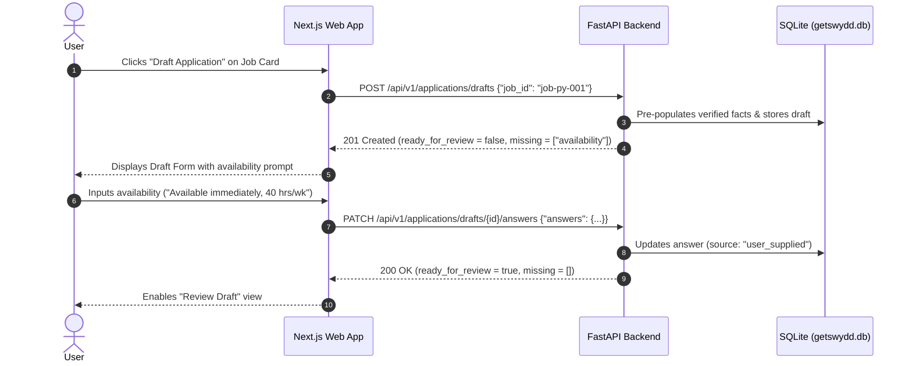

# GetSwydd API Contract

This document specifies the REST API contract implemented in the FastAPI backend (`api/`) for GetSwydd, including job discovery and the application drafting flow.

## Base URL & Configuration
- **Local Development:** `http://127.0.0.1:8000`
- **Allowed Frontend Origins:** `http://localhost:3000`, `http://127.0.0.1:3000`
- **Persistence:** SQLite (`getswydd.db`), surviving server restarts.

---

## 1. System & Jobs Endpoints

### 1.1 Health Check
Checks service availability.

- **Route:** `GET /health`
- **Method:** `GET`
- **Status Code:** `200 OK`

#### Response:
```json
{
  "status": "healthy",
  "service": "getswydd-api",
  "version": "0.1.0"
}
```

---

### 1.2 Job Catalog
Retrieves open job opportunities.

- **Route:** `GET /api/v1/jobs`
- **Method:** `GET`
- **Status Code:** `200 OK`

#### Response:
```json
{
  "total": 2,
  "jobs": [
    {
      "id": "job-py-001",
      "title": "Python Developer Internship",
      "company": "Aether Labs",
      "location": "Cardiff, UK (Hybrid)",
      "eligibility": "Students or recent grads proficient in Python 3, FastAPI or Flask, and basic Git workflow",
      "recommended_resume": "Backend_Python_Intern_Resume.pdf",
      "description": "Build scalable API microservices and automated job ingestion pipelines with Python and FastAPI.",
      "posted_date": "2026-11-20"
    },
    {
      "id": "job-da-002",
      "title": "Data Analyst Internship",
      "company": "Cymru Insights",
      "location": "Remote",
      "eligibility": "Proficiency in SQL, Python (pandas), and data visualization with strong communication skills",
      "recommended_resume": "Data_Analytics_Resume.pdf",
      "description": "Analyze labor market trends, extract job market insights, and assist in matching algorithms.",
      "posted_date": "2026-11-21"
    }
  ]
}
```

---

## 2. Application Draft Endpoints

The drafting flow adheres to **Rule 1 (Verified Facts Only)**: questions with verified profile facts are pre-populated; questions without verified facts (such as availability) are never guessed or hallucinated.

### 2.1 Create Application Draft
Initiates a draft for a target job. Pre-populates screening answers from verified candidate facts and selects the job's recommended resume.

- **Route:** `POST /api/v1/applications/drafts`
- **Method:** `POST`
- **Status Codes:**
  - `201 Created`: Draft created and stored in SQLite.
  - `404 Not Found`: Given `job_id` does not exist.

#### Request Body:
```json
{
  "job_id": "job-py-001"
}
```

#### Response (201 Created):
```json
{
  "id": "draft-a1b2c3d4e5",
  "job_id": "job-py-001",
  "job_title": "Python Developer Internship",
  "company": "Aether Labs",
  "candidate_name": "Alex Morgan",
  "selected_resume": "Backend_Python_Intern_Resume.pdf",
  "screening_questions": [
    {
      "id": "python_experience",
      "question": "What experience do you have with Python, FastAPI, and backend development?",
      "required": true,
      "answer": "Proficient in Python 3, FastAPI, and Flask with 2 years of project and coursework experience.",
      "source": "verified_profile"
    },
    {
      "id": "work_authorization",
      "question": "Are you legally authorized to work in the UK for this role?",
      "required": true,
      "answer": "Authorized to work in the UK without visa sponsorship required.",
      "source": "verified_profile"
    },
    {
      "id": "availability",
      "question": "What is your earliest start date and weekly availability (e.g. 40 hours/week)?",
      "required": true,
      "answer": null,
      "source": null
    }
  ],
  "missing_required_questions": [
    "availability"
  ],
  "ready_for_review": false,
  "created_at": "2026-11-22T10:15:00.000000+00:00",
  "updated_at": "2026-11-22T10:15:00.000000+00:00"
}
```

#### Error Response (404 Not Found):
```json
{
  "detail": "Job not found with ID 'job-unknown-999'"
}
```

---

### 2.2 Retrieve Application Draft
Retrieves an existing draft by ID from SQLite storage.

- **Route:** `GET /api/v1/applications/drafts/{draft_id}`
- **Method:** `GET`
- **Status Codes:**
  - `200 OK`: Draft found.
  - `404 Not Found`: Draft ID does not exist.

#### Example Request:
`GET /api/v1/applications/drafts/draft-a1b2c3d4e5`

#### Response (200 OK):
Returns the complete `ApplicationDraft` object as detailed above.

#### Error Response (404 Not Found):
```json
{
  "detail": "Application draft not found with ID 'draft-nonexistent'"
}
```

---

### 2.3 Update Screening Answers
Supplies user answers for missing screening questions (or updates existing answers). Recomputes `missing_required_questions` and transitions `ready_for_review` to `true` when all required questions are answered.

- **Route:** `PATCH /api/v1/applications/drafts/{draft_id}/answers` (or `PUT`)
- **Method:** `PATCH` / `PUT`
- **Status Codes:**
  - `200 OK`: Answers updated successfully.
  - `400 Bad Request`: Payload contains an invalid question ID.
  - `404 Not Found`: Draft ID does not exist.

#### Request Body:
```json
{
  "answers": {
    "availability": "Available immediately from June 1st, 40 hours per week."
  }
}
```

#### Response (200 OK):
```json
{
  "id": "draft-a1b2c3d4e5",
  "job_id": "job-py-001",
  "job_title": "Python Developer Internship",
  "company": "Aether Labs",
  "candidate_name": "Alex Morgan",
  "selected_resume": "Backend_Python_Intern_Resume.pdf",
  "screening_questions": [
    {
      "id": "python_experience",
      "question": "What experience do you have with Python, FastAPI, and backend development?",
      "required": true,
      "answer": "Proficient in Python 3, FastAPI, and Flask with 2 years of project and coursework experience.",
      "source": "verified_profile"
    },
    {
      "id": "work_authorization",
      "question": "Are you legally authorized to work in the UK for this role?",
      "required": true,
      "answer": "Authorized to work in the UK without visa sponsorship required.",
      "source": "verified_profile"
    },
    {
      "id": "availability",
      "question": "What is your earliest start date and weekly availability (e.g. 40 hours/week)?",
      "required": true,
      "answer": "Available immediately from June 1st, 40 hours per week.",
      "source": "user_supplied"
    }
  ],
  "missing_required_questions": [],
  "ready_for_review": true,
  "created_at": "2026-11-22T10:15:00.000000+00:00",
  "updated_at": "2026-11-22T10:18:30.000000+00:00"
}
```

#### Error Response (400 Bad Request):
```json
{
  "detail": "Question 'invalid_field_id' is not a valid screening question for this draft."
}
```

---

## 3. Frontend Integration Flow



---

## 4. Approved Test Submission
Send `POST /api/v1/applications/drafts/{draft_id}/submit` after the candidate has reviewed the saved answers and selected resume name and explicitly approved that draft version.

```json
{
  "approved": true,
  "draft_updated_at": "2026-11-22T10:18:30.000000+00:00"
}
```

Use the draft's exact `updated_at` value. The server stores the approved payload in the local test employer's SQLite inbox and returns `200 OK` with a receipt. The receipt contains `id`, `draft_id`, `job_title`, `company`, `selected_resume`, `approved_updated_at`, `submitted_at`, `destination` (`local_test_employer`), and `status` (`submitted`). This sends sample data only to the local test inbox.

Repeated requests for the same draft version return the original receipt. The endpoint returns `404` for an unknown draft, `409` for a stale version or incomplete draft, and `422` without explicit approval. Draft responses include `submission`, which is null until the receipt exists. Updates to submitted drafts return `409`.

`GET /api/v1/applications` returns the confirmed test receipts in newest-first order for the application tracker.

## 5. Resumes and Confirmed Profile

| Endpoint | Request and response |
|---|---|
| `POST /api/v1/resumes` | Upload a multipart `file` field with a PDF or DOCX up to 5 MB. Returns the resume detail with `201`. Unsupported formats return `415`, oversize files return `413`, and unreadable files return `422`. |
| `GET /api/v1/resumes` | Lists uploaded resumes with their IDs, filenames, upload timestamps, and review status. |
| `GET /api/v1/resumes/{id}` | Returns a resume's extracted text, suggested facts, confirmed facts (initially `null`), and review revision. |
| `PUT /api/v1/resumes/{id}/review` | Takes the current `revision` and the complete reviewed `facts` object, then returns the updated resume detail. Returns `409` if the revision is stale. |
| `GET /api/v1/profile` | Returns `facts`, an array of merged profile facts with `category`, `value`, and `sources`. Each source includes its resume ID and filename. |

The review payload uses five groups of strings. Omit a group or send an empty array to confirm zero facts for that group.

```json
{
  "revision": 0,
  "facts": {
    "skills": ["Python", "SQL"],
    "education": ["B.Tech Computer Science"],
    "experience": [],
    "projects": ["Built a job tracker"],
    "certifications": []
  }
}
```

Suggestions come from text under common resume section headings. Reviewers can correct or remove any suggestion before confirming it. The profile merges equal facts within each category without regard to case or repeated spaces and retains every confirmed source. Files and profile data are stored locally in SQLite. The sample application workflow continues to use its synthetic candidate.

## 6. Explainable Job Matching

`GET /api/v1/jobs` includes a `match` object for each sample role. It contains:

- `has_confirmed_profile`, `matched_skills`, and `total_skills`. The counts cover skill groups only. For an alternative such as FastAPI or Flask, either skill supports the group once.
- `requirements`, with a label, status, and confirmed evidence and resume sources. Status is `evidence_found`, `no_confirmed_evidence`, or `needs_confirmation`. Student or recent-graduate status and work authorization need confirmation and do not enter the counts.
- `recommended_resume`, with the uploaded resume ID, filename, and the skill requirements that document supports. The reviewed resume with the most covered groups wins. Ties use filename and then ID. An empty match yields `null`.

Rules use explicit skill names and aliases from confirmed profile facts, with case and whitespace normalized. The sample catalog order and top-level `recommended_resume` field are preserved. That top-level field supplies the synthetic test draft's filename. Personal resume recommendations are in `match.recommended_resume`.

## 7. Personalized Application Drafts

Use `GET /api/v1/profile/application-details` to load the candidate's saved application details. Use `PUT` on the same path to confirm the complete set. Omitted fields and explicit `null` both clear a field. A name is required to start a personalized draft. Availability and UK work authorization may be left unknown.

```json
{
  "candidate_name": "Casey Doe",
  "availability": "June, 20 hours per week",
  "uk_work_authorization": null
}
```

`uk_work_authorization` accepts `authorized`, `not_authorized`, or `null`.

To start a personalized draft, send the selected upload's ID in the existing create request:

```json
{
  "job_id": "job-py-001",
  "resume_id": "resume-<id from GET /api/v1/resumes>"
}
```

The API returns `201` with the existing draft fields plus:

- `mode: "personalized"` and `resume_id` identifying the chosen upload. `candidate_name` and `selected_resume` contain the name and filename shown to the candidate.
- Each `screening_questions` item includes an `evidence` array. Resume-based entries have `value` and `resume: { "resume_id": "...", "filename": "..." }`. Confirmed profile entries have `value` and `profile_field` (`availability` or `uk_work_authorization`). Unanswered questions return `answer: null` and an empty `evidence` array.
- `missing_required_questions` and `ready_for_review` remain the controls for the review screen. A user edit has `source: "user_supplied"` and clears the corresponding prefill evidence.

Example response excerpt when the user still needs to answer the work authorization question:

```json
{
  "mode": "personalized",
  "resume_id": "resume-example",
  "candidate_name": "Casey Doe",
  "selected_resume": "Backend.pdf",
  "screening_questions": [
    {
      "id": "work_authorization",
      "question": "Are you legally authorized to work in the UK for this role?",
      "required": true,
      "answer": null,
      "source": null,
      "evidence": []
    }
  ],
  "missing_required_questions": ["work_authorization"],
  "ready_for_review": false
}
```

An unknown resume returns `404`. An unreviewed resume or a missing candidate name returns `409` with a `detail` message. Drafts retain their original profile snapshot after later edits to the profile or resume review. Sending only `job_id` creates a `demo` draft eligible for the test inbox. Personalized drafts are saved for review, and their submission endpoint returns `409`.

## 8. Greenhouse Job Discovery

In the PowerShell terminal that runs FastAPI, set `GETSWYDD_GREENHOUSE_BOARDS` to a JSON object mapping up to five approved public board tokens to their employer display names. Use the board token from the Greenhouse link on the employer's own careers page.

```powershell
$env:GETSWYDD_GREENHOUSE_BOARDS = '{"board-token":"Employer Name"}'
```

Start or restart FastAPI from that terminal. To sync a board and read the imported jobs:

```powershell
Invoke-RestMethod -Method Post "http://127.0.0.1:8000/api/v1/jobs/greenhouse/refresh"
Invoke-RestMethod "http://127.0.0.1:8000/api/v1/jobs?source=greenhouse"
```

- **Refresh** returns one record per configured board with `board`, `status`, and `count`. Status is `refreshed`, `cached` (the last success was less than five minutes ago), or `failed` (the last successful snapshot is kept). A successful refresh replaces the board snapshot, including removing jobs the feed no longer lists. With zero configured boards, refresh returns `[]`.
- **List** accepts `source=demo` (the default), `source=greenhouse`, or `source=all`. It reads the local snapshot. Each Greenhouse job has `source: "greenhouse"`, `application_mode: "assisted"`, an HTTPS `apply_url` from the provider, a plain-text description, and `source_fetched_at`. The provider's update timestamp is `source_updated_at`. For imported jobs, `posted_date`, `eligibility`, and the top-level demo resume may be null.
- **Matching** compares recognized skill mentions in the description against confirmed profile facts. `match.scope` is `description_mentions`. Display those as skill mentions, since employer requirements and eligibility still need review. When none of the supported skills appear, `match` is null. For boards whose descriptions exceed the response limit, the importer uses the provider's shorter feed, which contains links but may omit descriptions and matches.
- **Apply** shows a link to `apply_url` for `application_mode: "assisted"`. To prepare a draft first, follow section 9. The user completes the application on the employer's page.

An invalid board configuration returns `503` on Greenhouse-specific queries. Greenhouse receives public listing and form reads. Candidate details and resumes stay local.

## 9. Assisted Applications for Greenhouse Jobs

Send the imported job ID and a reviewed resume ID to `POST /api/v1/applications/drafts`:

```json
{
  "job_id": "greenhouse:example:123",
  "resume_id": "resume-example"
}
```

On `201`, the existing draft response includes `mode: "assisted"`, the selected resume, confirmed name, and `apply_url`. Show **Open employer application** using the returned URL. A missing reviewed resume or confirmed candidate name returns `409`. A job outside the configured, cached listings returns `404`. If Greenhouse confirms the posting closed, creation returns `409` and asks for a job refresh.

| Field | Frontend behavior |
|---|---|
| `form_status: "loaded"` | Show the imported custom text and single-select questions below the profile information. |
| `form_status: "partial"` | Show the questions that could be imported and tell the user to complete the other fields on the employer's page. |
| `form_status: "unavailable"` | Show the employer link and selected resume so the user can continue. The draft has no imported questions. |
| `screening_questions[].choices` | Use a text input if empty, otherwise offer the listed values. Save by sending the selected label as the answer string. |
| `ready_for_review` | Reports completion of the local screening questions. The employer's form may ask for additional information. |

Use the existing answer update route to save changes. Prefill requires a direct match to a supported confirmed profile field. Other responses remain blank until the user fills them in. Fields for file uploads, consent, and demographics are completed on the employer's page.

Use `GET /api/v1/applications/assisted` to list the real drafts in the tracker. After the user says they finished on the employer's site, send `PUT /api/v1/applications/drafts/{id}/reported-submission` with `{"submitted":true}`. The response combines the tracker status and job details:

```json
{
  "draft_id": "draft-example",
  "job_id": "greenhouse:example:123",
  "job_title": "Backend Internship",
  "company": "Example Employer",
  "selected_resume": "Backend.pdf",
  "apply_url": "https://job-boards.greenhouse.io/example/jobs/123",
  "status": "submitted",
  "status_source": "user_reported",
  "reported_submitted_at": "2026-11-22T12:00:00Z",
  "updated_at": "2026-11-22T12:00:00Z"
}
```

Before reporting, entries have `status: "draft"`, `status_source: "getswydd"`, and a null submission time. Repeating a report returns the same timestamp, and reported drafts become read-only. The original test inbox endpoint accepts demo drafts. Employer communications for assisted drafts are limited to public form reads. The tracker records the user's account of completion.

## 10. Job Search and Saved Preferences

`GET /api/v1/jobs/preferences` reads the local user's saved preferences. `PUT` to the same URL replaces them. Empty lists mean any role or location. Send `{}` to reset the settings.

```json
{
  "role_keywords": ["Python Developer", "Data Analyst"],
  "location_keywords": ["India", "Remote"],
  "internships_only": true
}
```

`GET /api/v1/jobs` accepts the following optional parameters. The existing source filter remains available.

| Parameter | Behavior |
|---|---|
| `q` | Requires all query words to appear in the job title or company name. |
| `location` | Requires all query words to appear in the provider's location text. |
| `use_preferences=true` | Applies saved role and location keywords. Words within each entry must all match. Entries in a category are alternatives, and the role and location categories both apply. |
| `internships_only=true` | Keeps listings with Intern or Internship in the title, including plurals. An explicit value overrides the saved internship setting. |
| `sort=match` | Orders jobs by confirmed skill count and then by the share of recognized skills confirmed. Ties preserve catalog order. |
| `limit`, `offset` | Page size (1–100) and zero-based offset. `total` counts all filtered results before paging. |

Example for the frontend's personalized listings view: `GET /api/v1/jobs?source=greenhouse&use_preferences=true&sort=match&limit=20`. Search uses the current local snapshot. Location text and skill matches help discovery and do not establish eligibility.
